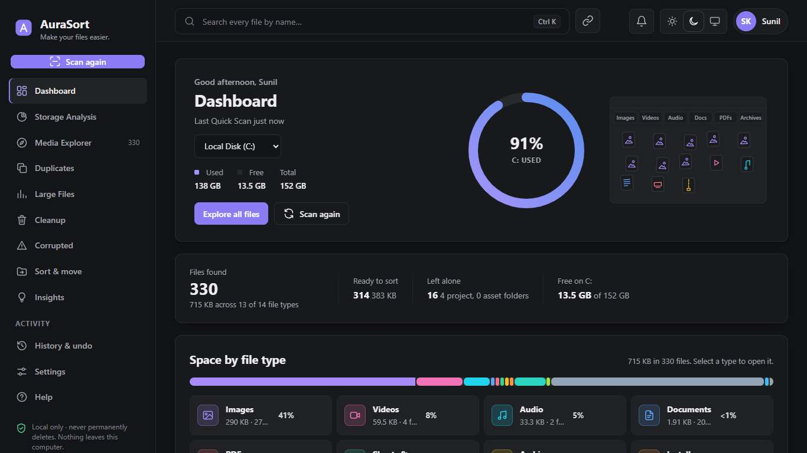
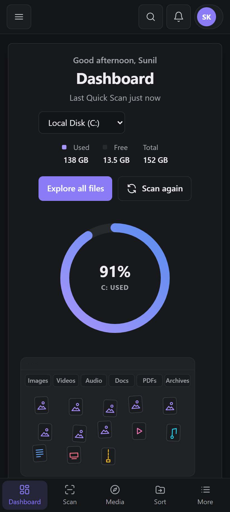
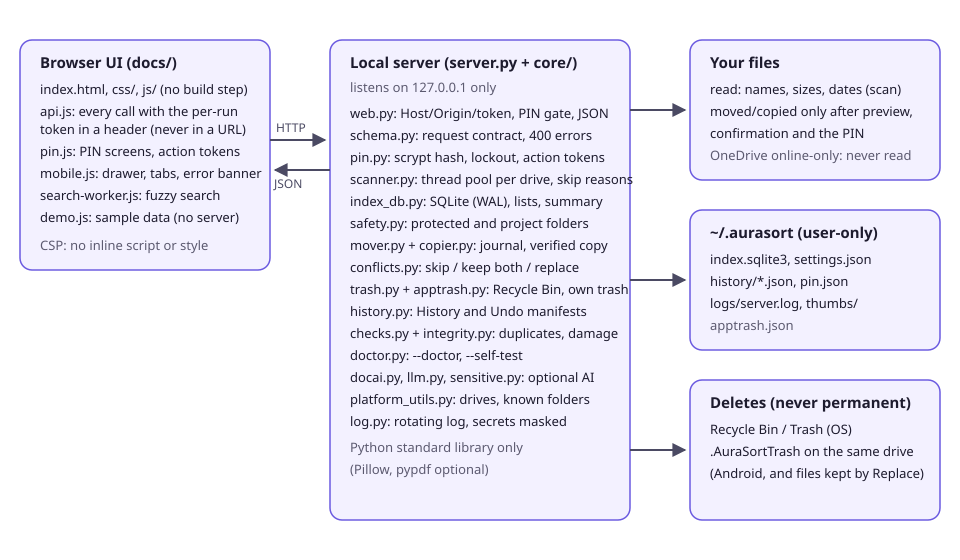
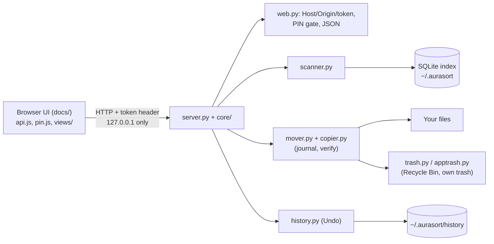

# AuraSort: project overview

Version 1.1.1 · Sunil Kumar (GitHub: skuser404) · https://github.com/skuser404/AuraSort

## 1. Pitch

AuraSort is a free, open-source file organizer and storage analyzer that runs only on your own computer. It scans your
folders or whole drives (names, sizes and dates only), shows where your space goes, finds duplicate and damaged files,
and moves or copies files into tidy folders after showing you exactly what will happen. It is a small Python server on
`127.0.0.1` with a browser interface, uses only the Python standard library, never deletes anything permanently (the
Recycle Bin, or its own trash folder on Android), records every move so it can be undone, and asks for a PIN before any
action that changes files.

### Two-minute demo script

| Time | Click | Say |
|---|---|---|
| 0:00 | Open `http://localhost:8765/` (or the public demo) | "AuraSort runs on my own computer. The page talks to a tiny local server; nothing goes to the internet." |
| 0:15 | *Before you start* > tick > Continue > *This computer* > set PIN | "First run: terms, which computer this is, and a PIN. The PIN is checked by the server, not just the page." |
| 0:35 | Scan > Quick Scan > Start | "Quick Scan reads my usual folders, also when Windows keeps them in OneDrive. It reads names, sizes and dates only." |
| 0:50 | Dashboard | "Space by type, biggest folders and files. Every number comes from the same database rows, so they always add up." |
| 1:05 | Media Explorer > tick 2 files > Move to... > pick a folder | "Before anything moves, it shows what will happen, and project folders such as a website are left alone." |
| 1:20 | (a name clash appears) Replace > enter PIN | "If a file with that name is already there, I choose: skip, keep both or replace. Replace keeps the old file, so Undo can restore it." |
| 1:35 | History > Undo > PIN | "Every move is journaled before it starts, so it can be undone, even after a crash." |
| 1:45 | Resize the window to phone width | "The same interface works on a phone, including Android through Termux." |
| 1:55 | Settings > Diagnostics | "If a scan ever finds nothing on someone's PC, this report says exactly why, without any file names." |

## 2. Problem and solution

**Problem.** Downloads, Desktop and Documents fill up with thousands of files. Cloud "cleaner" tools want your files or
your account; big disk tools are hard to read; moving files by hand risks breaking projects (a website's `images/`
folder, a Premiere project) and mistakes cannot be undone.

**Solution.** A local tool that (1) lists every file with its size and folder, fast, (2) explains where space goes, (3)
moves files only after a preview, never into or out of protected and project folders unless you say so, (4) never deletes
permanently and keeps an undo journal, and (5) needs no account and makes no network requests.

**Target users.** Students and office workers with a messy Downloads folder; people with a nearly full laptop; people
who share a computer and want the file-moving tool itself locked with a PIN.

**Screenshots** (made by the test suite from made-up files; all are in `docs/screenshots/`):
desktop `desktop-dark-dashboard.jpg`, `desktop-light-media.jpg`; phone `pixel7-dark-dashboard.jpg`,
`phone-360-light-media.jpg`.

## 3. Features and their status

Status: **Working** = implemented and covered by automated tests that pass; **Partial** = implemented, with a limit
stated; **Planned** = not built.

| Area | Feature | Status |
|---|---|---|
| Scan | Quick Scan (Windows Known Folders incl. OneDrive, macOS home folders, Linux XDG, Android storage) and Deep Scan (drives + folders) with pause, resume, cancel and an estimate | Working |
| Scan | Every skipped item counted with a reason; a scan with 0 files always explains why | Working |
| Categories | 14 categories by extension; view-only types (installers, code, databases...) listed but not moved | Working |
| Protection | System folders never scanned; project folders (`package.json`, `.git`, `.sln`, media projects, websites) left alone; the scan root needs strong evidence | Working |
| Move / copy | Preview, same-drive rename, cross-drive copy verified with BLAKE2b before the source is removed | Working |
| Delete | Recycle Bin / Trash only (Windows, macOS Finder, Linux freedesktop); AuraSort's own trash on Android | Working (Android: Partial, simulated) |
| Undo / History | Journal written before a job starts; Undo for moves; Resume or Clean up after a crash | Working |
| Duplicates | Size, then first/last 64 KB, then every byte | Working |
| Large files, Cleanup | Biggest files; unfinished downloads, temp files, empty files, old installers (review only) | Working |
| Corrupted files | Read-only structure check (quick) or full read (deep), with likely cause and what to do | Working |
| Search | Fuzzy name search in a Web Worker; format, folder and date filters in the URL | Working |
| Preview | Pictures, video, audio, PDF, text; programs and scripts are never opened | Working |
| Themes, layout | Dark, light, system; phone, tablet and desktop layouts (checked at 360-1366 px) | Working |
| PIN lock | Server-enforced: unlock, single-use action tokens, idle lock, persisted lockout, Forgot PIN | Working |
| Name clashes | Skip / Keep both / Replace, per file or for all, identical content detected; Replace is undoable | Working |
| Diagnostics | `--doctor`, Settings > Diagnostics, installer `--self-test` | Working |
| Document Insights (AI) | Optional local model (Ollama / LM Studio) or a cloud API; rule-based confidential flags | Partial: tested with a mock engine, not with a real model on this machine |
| Install | One-line installers for Windows and macOS/Linux, Termux script | Partial: verified on Windows here and in CI on clean runners; the release that hosts them still has to be published |
| Public demo | GitHub Pages site and in-browser demo with sample data | Partial: verified locally under the same sub-path; GitHub Pages must be switched on once |
| Android | Termux with the phone layout | Partial: simulated in tests, not run on a real phone |
| Native app, signed installers | | Planned |

## 4. Architecture

| File | What it does |
|---|---|
| `server.py` | Routes only; validates input through `core/schema.py`; starts the server on 127.0.0.1; `--doctor`, `--self-test` |
| `core/web.py` | Host/Origin/token checks, the PIN gate for every route, guarded routes consume an action token, JSON errors `{error, code, hint}` |
| `core/schema.py` | The request contract: the fields each POST route reads, typed helpers, readable 400 errors |
| `core/pin.py` | PIN hash (scrypt), lockout, unlocked session with idle timeout, single-use action tokens bound to a request |
| `core/scanner.py` | Background scan: one thread pool per drive, `os.scandir`, one SQLite writer thread, skip reasons, explanations |
| `core/index_db.py` | SQLite index (WAL), schema versioning and migration, lists, filters, summary, consistency check |
| `core/safety.py` | Protected locations, project detection, safe names, no-overwrite naming |
| `core/mover.py`, `core/copier.py` | Move/copy jobs: journal first, re-check every file, rename or verified copy, name clashes, Undo |
| `core/conflicts.py` | Name-clash preview and choices |
| `core/trash.py`, `core/apptrash.py` | Recycle Bin / Trash; AuraSort's own trash with Restore |
| `core/history.py`, `core/jobs.py` | Manifests for History/Undo; background jobs with pause/resume/cancel and ETA |
| `core/checks.py`, `core/integrity.py` | Duplicates, cleanup rules, read-only integrity checks |
| `core/doctor.py` | Diagnostics and the installer self-test |
| `core/platform_utils.py` | OS specifics: drives, known folders, reparse points, long paths, opening files |
| `docs/` | The interface (plain HTML/CSS/JS), also the public demo |

## 5. Security and privacy design

- **Local only.** The server binds to 127.0.0.1. Every API call needs a random per-run token in a header (constant-time
  compare). The Host header must be a loopback name with the right port (blocks DNS rebinding); Origin and
  `Sec-Fetch-Site` must be same-origin (blocks cross-site requests). Preview links are short-lived HMAC-signed URLs, so the
  token never appears in a URL.
- **Strict page.** Content-Security-Policy without inline script or style, `X-Frame-Options: DENY`, `nosniff`,
  no referrer. Every file name is HTML-escaped; right-to-left override characters are neutralised.
- **No telemetry, no network.** Tests block outgoing connections while the server runs. The only exception is the optional
  cloud AI, off by default, with its own consent and a confirmation per batch.
- **Never a permanent delete.** Recycle Bin / Trash only; drives without one are refused; Android uses AuraSort's own trash.
- **Time-of-check races.** Right before acting, each file is re-checked: still a regular file (not a link), same folder,
  same size and date, not protected. Moves never overwrite.
- **Path safety.** The browser sends file ids, never paths; user-typed paths are canonicalised (8.3 names, links) before
  the protection rules; destination sub-folders are sanitised and must stay inside the destination.
- **PIN.** 4 or 6 digits; stored as a random 16-byte salt and scrypt (N=2^15), never the PIN; constant-time compare;
  lockout after 5 wrong tries (30 s, 1, 5, 15 minutes) that survives a restart; idle lock after 10 minutes; move, copy,
  delete, undo, replace, data wipe and API-key changes each need a 60-second single-use token bound to that exact request.
- **Dependencies.** Python standard library only at runtime; Pillow and pypdf optional and pinned; no front-end
  dependencies or CDNs; GitHub Actions pinned to commit SHAs (one, `upload-artifact`, still by tag); bandit and CodeQL in CI.
- **Honest limits.** The PIN protects AuraSort, not the OS account: anyone signed in can use Explorer or a terminal, and a
  copied `pin.json` can be brute-forced offline (10,000 or 1,000,000 values). Any other local user can reach 127.0.0.1
  while the server runs. Cloud AI providers keep data under their own policies.

## 6. Data flow of a move

1. The page sends **file ids** and the destination; the server resolves them in its own index and applies the rules
   (protected, project, view-only); the page shows the exact preview and any name clashes.
2. The PIN prompt returns a single-use token for exactly this request; the server consumes it before the job starts.
3. The **journal (manifest) is written first**, listing every planned file, so an interrupted job can be resumed or
   cleaned up.
4. For each file: re-check it (regular file, same folder, size and date); resolve a name clash as chosen (Replace first
   moves the existing file into AuraSort's trash on the same drive).
5. Same drive: an atomic rename that never overwrites. Other drive: copy into a temporary `.aurasort-part` file,
   **fsync**, verify with a full BLAKE2b hash (or size + sampled blocks if chosen), rename to a free name, and only then
   remove the source.
6. The index and the journal are updated per file. **Undo** moves every file back (never over another file) and restores
   any file that Replace set aside.

## 7. Tech stack, testing, install

**Stack and why.** Python 3.10+ standard library (`http.server`, `sqlite3`, `hashlib`, `ctypes` for Windows APIs): nothing
to install, nothing to audit beyond the standard library, works on Windows, macOS, Linux and Termux. SQLite in WAL mode:
one file, fast lists of 200,000 files, readers while a scan writes. Plain HTML/CSS/JS: no build step, so the code you
read is the code that runs, and the same files are the public demo.

**Testing and CI.**
- 265 unit and API tests (temporary homes; the real data folder and Recycle Bin are never touched).
- `tests/acceptance/run_acceptance.py`: the real server in a brand-new home, driven like the UI, 14 variants (host
  headers, OneDrive paths, project roots, Android with and without storage access, corrupt and old data). Passes on
  Python 3.10, 3.12, 3.13 and 3.14.
- Browser tests: `tests/e2e/*.mjs` (Edge via the DevTools protocol), `full.pw.mjs` (whole app, 66 checks),
  `responsive.pw.mjs` (13 pages x 4 sizes x 2 themes, no sideways scrolling), `demo_live.pw.mjs` (the public demo).
- CI (GitHub Actions): Windows, macOS, Linux x Python 3.10, 3.12, 3.13, 3.14 for unit tests, install + smoke test, the
  README's commands and links; browser tests on Windows; bandit; CodeQL.

**Install and run.**
- Windows: `irm https://github.com/skuser404/AuraSort/releases/latest/download/install.ps1 | iex` (normal PowerShell,
  not as administrator), or `git clone`, `cd AuraSort`, `py -m pip install --user -r requirements.txt`, `py server.py`.
- macOS / Linux: `curl -fsSL https://github.com/skuser404/AuraSort/releases/latest/download/install.sh | sh`.
- Android (Termux): `pkg update -y && pkg install -y python git && git clone https://github.com/skuser404/AuraSort.git && cd AuraSort && bash install-termux.sh`.

**Troubleshooting.** The README has a table built from real errors (404, System32, `py` not recognised, Store alias,
ExecutionPolicy, SmartScreen, port in use, 0 files, Termux storage, macOS Full Disk Access). For "0 files":
`py server.py --doctor` prints a report without file names.

## 8. Interview questions and honest answers

1. **Why only the standard library?** No supply-chain risk at runtime and nothing to install; the installers add Pillow
   and pypdf only as optional extras.
2. **How do you prevent data loss?** No permanent delete anywhere; moves never overwrite; cross-drive moves delete the
   source only after a verified copy; a journal is written before every job; Undo.
3. **What if the power fails mid-move?** The journal says what was planned and done; History offers Resume or Clean up;
   a half-written copy is only ever a `.aurasort-part` file, and the source still exists.
4. **Symlinks and junctions?** They are skipped (counted as "links") so scans cannot loop or escape a folder. Windows
   reparse points that are not links (OneDrive placeholders) are listed; skipping those was a real bug that made OneDrive
   folders look empty.
5. **How does the PIN work, and what are its limits?** scrypt hash, persisted lockout, server-side session and single-use
   tokens per action. It stops casual misuse of the app, not someone already signed in to the OS account.
6. **Why not just check the PIN in the browser?** Anything in the page can be bypassed by calling the API directly; the
   tests call every guarded route without a token and require a 403.
7. **How did you debug "0 files on my friend's PC" without that PC?** Built a doctor command and an acceptance suite that
   reproduces each suspected cause; it found real bugs (OneDrive reparse points, a refused `[::1]` host, Android without
   storage access giving a misleading message, a silent failed refresh).
8. **How do you keep numbers consistent (the 197% report)?** Every share is computed by one clamped function, online-only
   files are left out of disk shares, and a consistency check compares totals, categories and lists.
9. **What was hard?** Cross-platform details: Windows long paths, OneDrive placeholders, file locks (Windows cannot
   replace an open file), Termux storage permissions, PowerShell 5.1 exit codes leaking out of an installer.
10. **How is the local server protected from other websites?** Token header, Host and Origin checks, same-origin fetch
    metadata, no CORS, strict CSP.
11. **How fast is it?** Scans use a thread pool sized by drive type and one batched SQLite writer; search runs in a Web
    Worker. `tools/benchmark.py` prints measured numbers for the machine it runs on.
12. **How is it tested?** Unit, API, acceptance and browser tests, on four Python versions and three OSes in CI.
13. **What about privacy for the optional AI?** Off by default; local engines only on 127.0.0.1; for cloud, numbers and
    IDs are masked, confidential files held back, and every batch is confirmed.
14. **What would you do next?** Publish signed releases, a native Android interface, packaging as a desktop app.
15. **What does not work yet?** See the limitations below; for example, the Linux/macOS CI unit-test failures of the
    1.1.0 run were not diagnosed on this machine.

## 9. Roadmap

- Android: a native interface (today: Termux + the browser, with a phone layout).
- Signed installers (code-signed Windows installer, notarised macOS app).
- Document Insights: tested with real local models, image descriptions.
- Packaging as a desktop app (one double-click, no terminal window).

## 10. Known limitations

- Not run on a real Android phone or a real Mac during this work: Android is simulated in tests; macOS and Linux are
  covered only by CI runners.
- The 1.1.0 CI run failed its unit tests on Linux and macOS for reasons that could not be read here (the logs need a
  signed-in account); the CI now names every failing test on the run page.
- The one-line installers download from a GitHub Release, which has to be published (the 1.1.0 release job failed
  before it could publish).
- GitHub Pages must be switched on once in the repository settings before the website and demo deploy.
- Document Insights was tested with a mock model server only.
- The PIN is not an operating-system password (see section 5).
