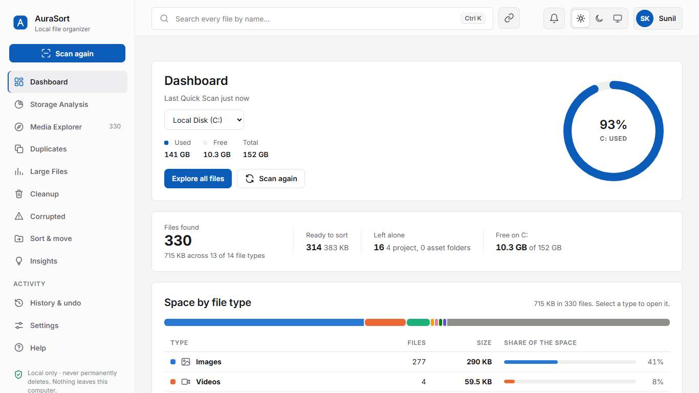
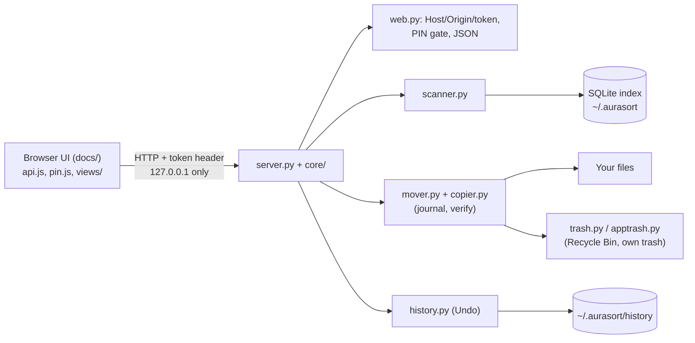

# AuraSort: project overview

Version 1.1.3 · Sunil Kumar (GitHub: skuser404) · https://github.com/skuser404/AuraSort

## 1. Pitch

AuraSort is a free, open-source file organizer and storage analyzer that runs only on your own computer. It scans your
folders or whole drives (names, sizes and dates only) and shows where your space goes. It finds duplicate and damaged
files, and it moves or copies files into tidy folders after showing exactly what will happen.

It is a small Python server on `127.0.0.1` with a browser interface, and it uses only the Python standard library. It
never deletes anything permanently: files go to the Recycle Bin, or to its own trash folder on Android. Every move is
recorded so it can be undone, and a PIN is needed before any action that changes files.

### Two-minute demo script

| Time | Click | Say |
|---|---|---|
| 0:00 | Administrator PowerShell: the one install command (section 7) | "One command installs Python if needed, AuraSort and the shortcuts, runs a self-test and starts it." |
| 0:20 | *Before you start* > tick > Continue > *This computer* > set PIN | "First run: terms, which computer this is, and a PIN. The server checks the PIN, not just the page." |
| 0:35 | (nothing: the scan starts by itself) | "The first start scans my usual folders, also when Windows keeps them in OneDrive. It reads names, sizes and dates only." |
| 0:50 | Dashboard | "Space by type, biggest folders and files. Every number comes from the same database rows, so they always add up." |
| 1:05 | *Suggested organization* > Apply | "It suggests where everything would go. Apply opens the exact preview; nothing moves until I confirm with my PIN." |
| 1:20 | (a name clash appears) Replace > PIN | "If a file with that name is already there, I choose: skip, keep both or replace. Replace keeps the old file, so Undo can restore it." |
| 1:35 | History > Undo > PIN | "Every move is journaled before it starts, so it can be undone, even after a crash." |
| 1:45 | Resize the window to phone width | "The same interface works on a phone, including Android through Termux." |
| 1:55 | Settings > Diagnostics | "If a scan ever finds nothing on someone's PC, this report says exactly why, without any file names." |

## 2. Problem and solution

**Problem.** Downloads, Desktop and Documents fill up with thousands of files. Cloud "cleaner" tools want your files or
your account, and big disk tools are hard to read. Moving files by hand risks breaking projects (a website's `images/`
folder, a Premiere project), and mistakes cannot be undone.

**Solution.** A local tool that:
1. lists every file with its size and folder, fast;
2. explains where space goes;
3. moves files only after a preview, and never into or out of protected and project folders unless you say so;
4. never deletes permanently, and keeps an undo journal;
5. needs no account and makes no network requests.

**Target users.** Students and office workers with a messy Downloads folder; people with a nearly full laptop; people
who share a computer and want the file-moving tool itself locked with a PIN.

**Look.** The interface is deliberately plain, like a utility (File Explorer and a disk analyser): neutral greys, one
accent, flat surfaces, tables for tabular data, real numbers, and motion only where it explains something. The design
rules are in `docs/DESIGN.md`. The screenshots in `docs/screenshots/` are made by the test suite from made-up files.

## 3. Features and their status

Status: **Working** = implemented and covered by automated tests that pass. **Partial** = implemented, with a stated
limit. **Planned** = not built.

| Area | Feature | Status |
|---|---|---|
| Install | Windows: one command, administrator permission (asked once), Python 3.12 if missing (winget or a SHA-256-pinned python.org installer), shortcuts, self-test, first start; standard mode if the prompt is declined | Working (Windows PowerShell 5.1 here and in CI; PowerShell 7 in CI only) |
| Install | macOS/Linux one-liner (brew or apt/dnf/pacman/zypper with a prompt), Termux script | Partial: run in CI on clean runners, not on a real Mac here |
| First start | Automatic Quick Scan, then "Suggested organization: N files into M folders" with Apply (preview + PIN) | Working |
| Scan | Quick Scan (Windows Known Folders incl. OneDrive, macOS home folders, Linux XDG, Android storage) and Deep Scan (drives + folders) with pause, resume, cancel and an estimate | Working |
| Scan | Every skipped item counted with a reason; a scan with 0 files, or refused folders, shows a card with exact counts and what to do | Working |
| Categories | 14 categories by extension; view-only types (installers, code, databases...) listed but not moved | Working |
| Protection | System folders never scanned; project folders (`package.json`, `.git`, `.sln`, media projects, websites) left alone; the scan root needs strong evidence | Working |
| Move / copy | Preview; same-drive rename; cross-drive copy verified with BLAKE2b before the source is removed; Android shared storage without hard links | Working |
| Delete | Recycle Bin / Trash only (Windows, macOS Finder, Linux freedesktop); AuraSort's own trash on Android | Working (Android: Partial, simulated) |
| Undo / History | Journal written before a job starts; Undo for moves; Resume or Clean up after a crash | Working |
| Duplicates, Large files, Cleanup | Size, then first/last 64 KB, then every byte; biggest files; unfinished downloads, temp and empty files, old installers (review only) | Working |
| Corrupted files | Read-only structure check (quick) or full read (deep), with likely cause and what to do | Working |
| Search | Fuzzy name search in a Web Worker; format, folder and date filters in the URL | Working |
| Preview | Pictures, video, audio, PDF, text; programs and scripts are never opened | Working |
| Themes, layout | Dark, light, system; phone, tablet and desktop layouts (checked at 360-1366 px for sideways scrolling and squeezed text) | Working |
| PIN lock | Server-enforced: unlock, single-use action tokens, idle lock, persisted lockout, Forgot PIN | Working |
| Name clashes | Skip / Keep both / Replace, per file or for all; identical content detected; Replace is undoable | Working |
| Diagnostics | `--doctor`, Settings > Diagnostics, installer `--self-test` | Working |
| Document Insights (AI) | Optional local model (Ollama / LM Studio) or a cloud API; rule-based confidential flags | Partial: tested with a mock engine, not a real model |
| Public demo | GitHub Pages site and in-browser demo with sample data | Partial: verified locally; GitHub Pages is not switched on yet |
| Android | Termux with the phone layout | Partial: simulated in tests, not run on a real phone |
| Native app, signed installers | | Planned |

## 4. Architecture

| File | What it does |
|---|---|
| `server.py` | Routes only; validates input through `core/schema.py`; starts the server on 127.0.0.1; `--doctor`, `--self-test` |
| `core/web.py` | Host/Origin/token checks, the PIN gate for every route, guarded routes consume an action token, JSON errors `{error, code, hint}` |
| `core/schema.py` | The request contract: the fields each POST route reads, typed helpers, path normalisation, readable 400 errors |
| `core/pin.py` | PIN hash (scrypt), lockout, unlocked session with idle timeout, single-use action tokens bound to a request |
| `core/scanner.py` | Background scan: a thread pool per drive, `os.scandir`, one SQLite writer thread, skip reasons, explanations |
| `core/index_db.py` | SQLite index (WAL), schema versioning and migration, lists, filters, summary, consistency check |
| `core/safety.py` | Protected locations, project detection, safe names, no-overwrite naming |
| `core/mover.py`, `core/copier.py` | Move/copy jobs: journal first, re-check every file, rename or verified copy, name clashes, Undo |
| `core/trash.py`, `core/apptrash.py` | Recycle Bin / Trash; AuraSort's own trash with Restore |
| `core/history.py`, `core/jobs.py` | Manifests for History/Undo; background jobs with pause/resume/cancel and ETA |
| `core/checks.py`, `core/integrity.py` | Duplicates, cleanup rules, read-only integrity checks |
| `core/doctor.py` | Diagnostics and the installer self-test |
| `core/platform_utils.py` | OS specifics: drives, known folders, reparse points, long paths, drive ids, opening files |
| `docs/` | The interface (plain HTML/CSS/JS; tokens in `css/theme.css`), also the public demo |
| `scripts/install.ps1`, `scripts/install.sh` | The one-line installers |

## 5. Security and privacy design

- **Local only.** The server binds to 127.0.0.1. Every API call needs a random per-run token in a header, compared in
  constant time. The Host header must be a loopback name with the right port, which blocks DNS rebinding. Origin and
  `Sec-Fetch-Site` must be same-origin, which blocks cross-site requests. Preview links are short-lived HMAC-signed
  URLs, so the token never appears in a URL.
- **Strict page.** A Content-Security-Policy without inline script or style, `X-Frame-Options: DENY`, `nosniff`, and no
  referrer. Every file name is HTML-escaped, and right-to-left override characters are neutralised.
- **No telemetry, no network.** Tests block outgoing connections while the server runs. The one font is self-hosted.
  The only exception is the optional cloud AI: off by default, with its own consent and a confirmation per batch.
- **Never a permanent delete.** Recycle Bin / Trash only; drives without one are refused; Android uses AuraSort's own
  trash.
- **Time-of-check races.** Right before acting, each file is re-checked: still a regular file (not a link), same
  folder, same size and date, not protected. Moves never overwrite.
- **Path safety.** The browser sends file ids, never paths. User-typed paths are normalised (drive roots, `\\?\`
  prefixes) and canonicalised (8.3 names, links) before the protection rules. Destination sub-folders are sanitised and
  must stay inside the destination.
- **PIN.** 4 or 6 digits, stored as a random 16-byte salt and an scrypt hash (N=2^15), never the PIN itself, and
  compared in constant time. Lockout after 5 wrong tries (30 s, 1, 5, 15 minutes) survives a restart. Idle lock after
  10 minutes. Move, copy, delete, undo, replace, data wipe, API-key changes and the administrator restart each need a
  60-second single-use token bound to that exact request.
- **Administrator on Windows (an owner decision).** The installer runs AuraSort elevated so Windows lets it read the
  user's folders. To keep that safe: the server still listens on 127.0.0.1 only and needs its token and the PIN;
  Windows system folders are never touched; the browser is opened through Explorer, so it does not run elevated; and
  declining the prompt gives standard mode. See `docs/DECISIONS.md`.
- **Dependencies.** Python standard library only at runtime. Pillow and pypdf are optional and pinned; pip-audit on
  2026-11-12 found 109 known issues in the old pins, and the new pins have none (Python 3.10 skips Pillow, which has no
  fixed version there). No front-end dependencies or CDNs. The Python installer that may be downloaded is pinned by
  SHA-256. GitHub Actions are pinned to commit SHAs (except `upload-artifact`, still by tag). bandit and CodeQL run in
  CI.
- **Honest limits.** The PIN protects AuraSort, not the OS account: anyone signed in can use Explorer or a terminal,
  and a copied `pin.json` can be brute-forced offline (10,000 or 1,000,000 values). Any other local user can reach
  127.0.0.1 while the server runs. Cloud AI providers keep data under their own policies.

## 6. Data flow of a move

1. The page sends **file ids** and the destination. The server resolves them in its own index and applies the rules
   (protected, project, view-only), and the page shows the exact preview and any name clashes.
2. The PIN prompt returns a single-use token for exactly this request; the server consumes it before the job starts.
3. The **journal (manifest) is written first**, listing every planned file, so an interrupted job can be resumed or
   cleaned up.
4. For each file, the server re-checks it (regular file, same folder, size and date) and resolves a name clash as
   chosen. Replace first moves the existing file into AuraSort's trash on the same drive.
5. **Same drive:** an atomic rename that never overwrites. **Other drive:** copy into a temporary `.aurasort-part`
   file, **fsync**, verify with a full BLAKE2b hash (or size + sampled blocks if chosen), rename to a free name, and
   only then remove the source. Android shared storage refuses hard links and file dates, so the copier falls back to a
   rename and keeps the verified copy without dates.
6. The index and the journal are updated per file. **Undo** moves every file back (never over another file) and
   restores any file that Replace set aside.

## 7. Tech stack, testing, install

**Stack and why.** Python 3.10+ standard library (`http.server`, `sqlite3`, `hashlib`, `ctypes` for Windows APIs):
nothing to install, nothing to audit beyond the standard library, and it works on Windows, macOS, Linux and Termux.
SQLite in WAL mode: one file, fast lists of 200,000 files, readers while a scan writes. Plain HTML/CSS/JS: no build
step, so the code you read is the code that runs, and the same files are the public demo.

**Testing and CI.**
- 288 unit and API tests, using temporary homes: the real data folder and Recycle Bin are never touched.
- `tests/acceptance/run_acceptance.py`: the real server in a brand-new home, driven like the UI, in 14 variants (host
  headers, OneDrive paths, project roots, Android with and without storage access, corrupt and old data). Passes on
  Python 3.10, 3.12, 3.13 and 3.14.
- Browser tests:
  - `tests/e2e/*.mjs` (Edge via the DevTools protocol: 81, 10 and 15 checks);
  - `full.pw.mjs`: the whole app, 65 checks;
  - `responsive.pw.mjs`: 13 pages x 4 sizes x 2 themes, with no sideways scrolling and no squeezed text, plus the
    permissions card and Move/Copy/Delete reachability; 25 checks;
  - `firstrun.pw.mjs`: the automatic first scan and the suggestion; 6 checks;
  - `demo_live.pw.mjs`: the public demo.
- CI (GitHub Actions), on Windows, macOS and Linux x Python 3.10, 3.12, 3.13 and 3.14:
  - unit tests;
  - install + smoke test;
  - the README's one-line command run from `C:\Windows\System32` in PowerShell 5.1 and 7;
  - the README's commands and links;
  - browser tests on an elevated Windows runner, where every failed check becomes an annotation on the run page;
  - bandit and CodeQL.

**Install and run.**
- **Windows:** open PowerShell as Administrator and run
  `irm https://raw.githubusercontent.com/skuser404/AuraSort/main/scripts/install.ps1 | iex`. A normal PowerShell works
  too; the installer asks for the permission itself.
- **macOS / Linux:** `curl -fsSL https://raw.githubusercontent.com/skuser404/AuraSort/main/scripts/install.sh | sh`.
- **Android (Termux):** `pkg update -y && pkg install -y python git && git clone https://github.com/skuser404/AuraSort.git && cd AuraSort && bash install-termux.sh`.

**Troubleshooting.** The README has a table built from real errors (404, an installer window that closed by itself,
ExecutionPolicy, `py` not recognised, Store alias, port in use, 0 files, Termux storage, macOS Full Disk Access). For
"0 files", `py server.py --doctor` in `%LOCALAPPDATA%\AuraSort` prints a report without file names.

## 8. Interview questions and honest answers

1. **Why only the standard library?** No supply-chain risk at runtime and nothing to install. The installers add Pillow
   and pypdf only as optional extras, and pip-audit decides their versions.
2. **How do you prevent data loss?** There is no permanent delete anywhere, and moves never overwrite. Cross-drive
   moves delete the source only after a verified copy. A journal is written before every job, and there is Undo.
3. **What if the power fails mid-move?** The journal says what was planned and done, and History offers Resume or Clean
   up. A half-written copy is only ever a `.aurasort-part` file, and the source still exists.
4. **A friend's PC showed "About 7,629 files", then "0 files". What was it?** On Windows, Python 3.12+ reports a drive's
   full 64-bit volume serial number. On about half of all drives it does not fit SQLite's signed 64-bit integer, so
   storing the first folder raised `OverflowError`, and every folder was skipped. The estimate never wrote to SQLite,
   so it still saw the files. I reproduced it with a fake 64-bit serial in a unit test, then folded the id into the
   signed range.
5. **Why did the macOS tests fail when Linux and Windows passed?** Starting a server took 37 s on the macOS runners
   against 1-2 s elsewhere: `http.server` does a reverse DNS lookup when it binds. I found it from the job timings
   (the logs need a sign-in), reproduced it by making that lookup slow, and removed it. That bug was real for every
   Mac user too.
6. **Why did the one-line installer never work through `irm | iex`?** Three bugs that only show up under `iex`: a UTF-8
   byte-order mark that PowerShell 5.1 turns into junk characters, `$PSCmdlet` being null, and `exit` closing the
   window. CI had only run the script as a file. Now CI runs the README's exact command from `C:\Windows\System32`.
7. **How does the PIN work, and what are its limits?** An scrypt hash, a persisted lockout, a server-side session and a
   single-use token per action. It stops casual misuse of the app, not someone already signed in to the OS account.
8. **Why not just check the PIN in the browser?** Anything in the page can be bypassed by calling the API directly.
   The tests call every guarded route without a token and require a 403.
9. **Why administrator on Windows, and is that safe?** It was the owner's decision, because many PCs refused folders
   otherwise. It does not lift Controlled Folder Access, and mapped drives disappear. The server stays loopback-only,
   with the token and the PIN, and declining the prompt gives standard mode. The trade-off is written down in
   `docs/DECISIONS.md`.
10. **How is the local server protected from other websites?** A token header, Host and Origin checks, same-origin
    fetch metadata, no CORS and a strict CSP.
11. **Someone said the UI looked AI-generated. What did you change?** I removed the causes, not just the colours: a
    mascot, greetings, a marketing tagline, gradients, decorative animation, a rainbow of 14 hues and equal tile
    grids. Now there are design tokens in one file, one accent, a self-hosted font with a fixed scale, a category
    palette validated for colour blindness, and tables for tabular data.
12. **How do you keep numbers consistent?** Every share is computed by one clamped function, online-only files are left
    out of disk shares, and a consistency check compares totals, categories and lists.
13. **How is it tested?** Unit, API, acceptance and browser tests, on four Python versions and three OSes in CI. Each
    bug found got a test that failed before the fix.
14. **What would you do next?** Signed releases, a native Android interface, and packaging as a desktop app.
15. **Did you build it alone?** It was built with AI assistance. I can explain and modify every part, and the decisions,
    trade-offs and debugging steps are written down in `docs/DECISIONS.md`, `FIX_LOG.md` and the tests.

## 9. Roadmap

- Android: a native interface (today: Termux + the browser, with a phone layout).
- Signed installers (a code-signed Windows installer, a notarised macOS app).
- Document Insights: tested with real local models, image descriptions.
- Packaging as a desktop app (one double-click, no terminal window).

## 10. Known limitations

- Not run on a real Android phone, a real Mac or a drive with a 64-bit volume serial during this work. Android is
  simulated in tests; macOS and Linux are covered by CI runners; the 64-bit serial is covered by a unit test with a
  fake serial.
- PowerShell 7 (`pwsh`) is not installed on the development PC, so the installer is verified under PowerShell 7 only
  in CI.
- GitHub Pages is not switched on yet. Until the owner does it once (Settings > Pages > Source: GitHub Actions), the
  website and demo are offline and the README link check fails.
- Running elevated (the Windows default) hides mapped network drives; scan them by their `\\server\share` path.
- Python 3.10 installs no Pillow (no fixed version exists), so thumbnails use the built-in, slower path.
- Document Insights was tested with a mock model server only.
- The PIN is not an operating-system password (see section 5).
